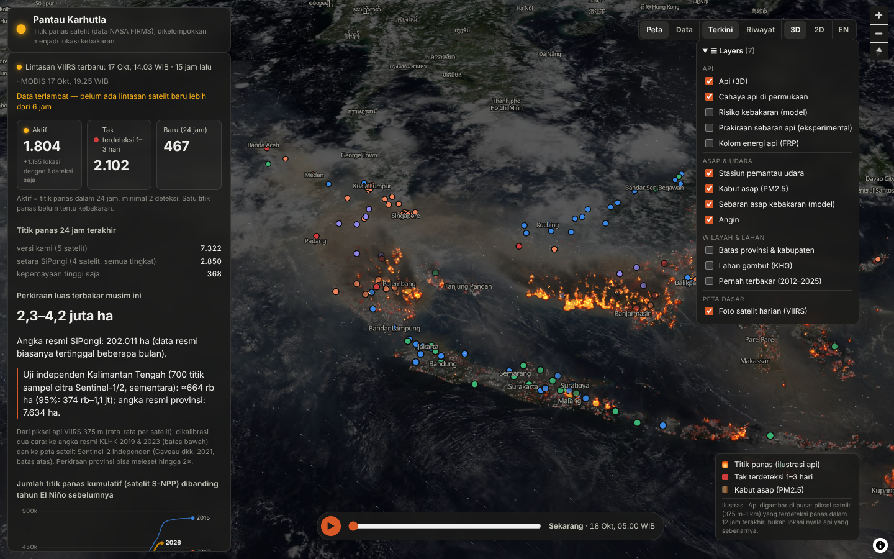
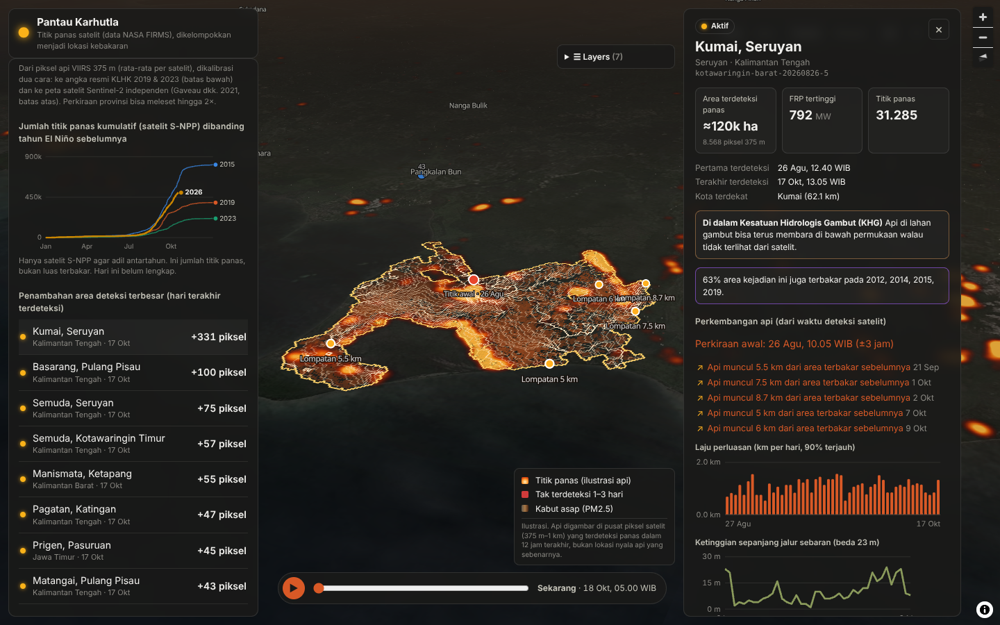
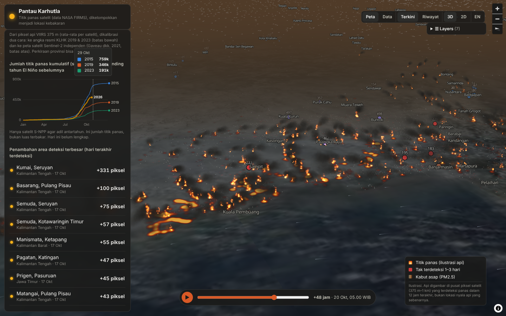
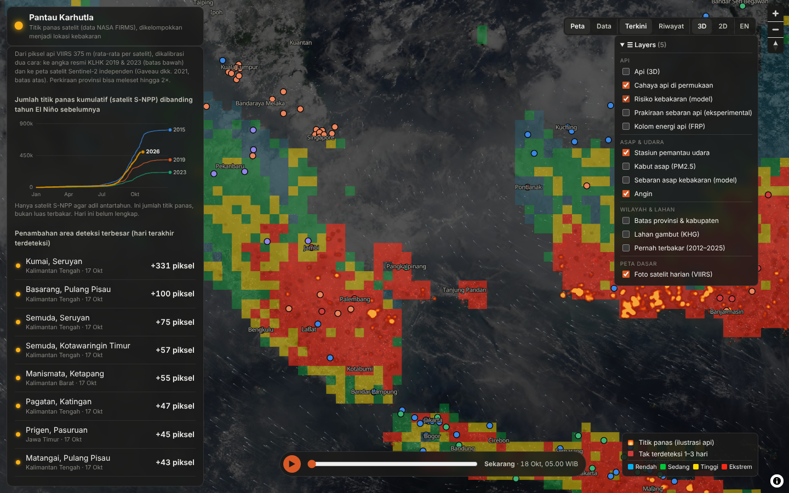
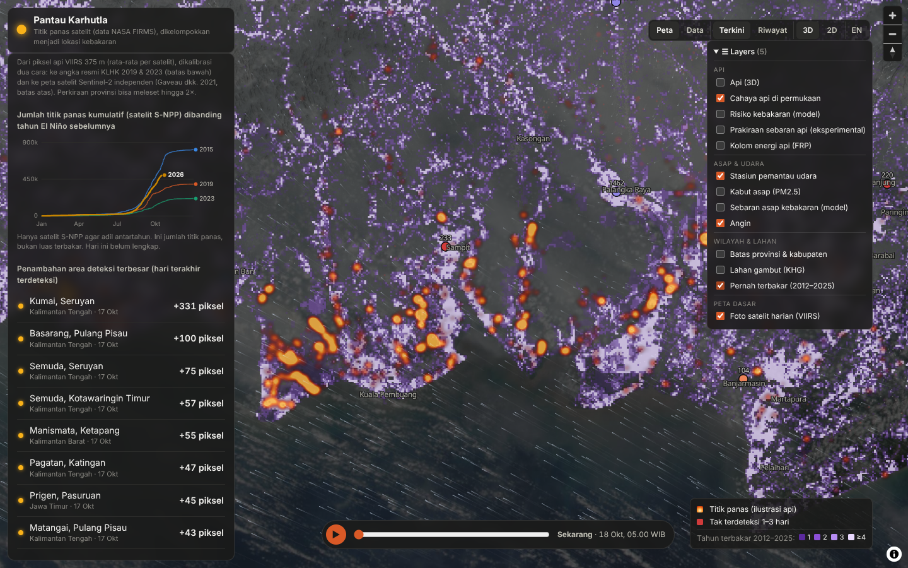
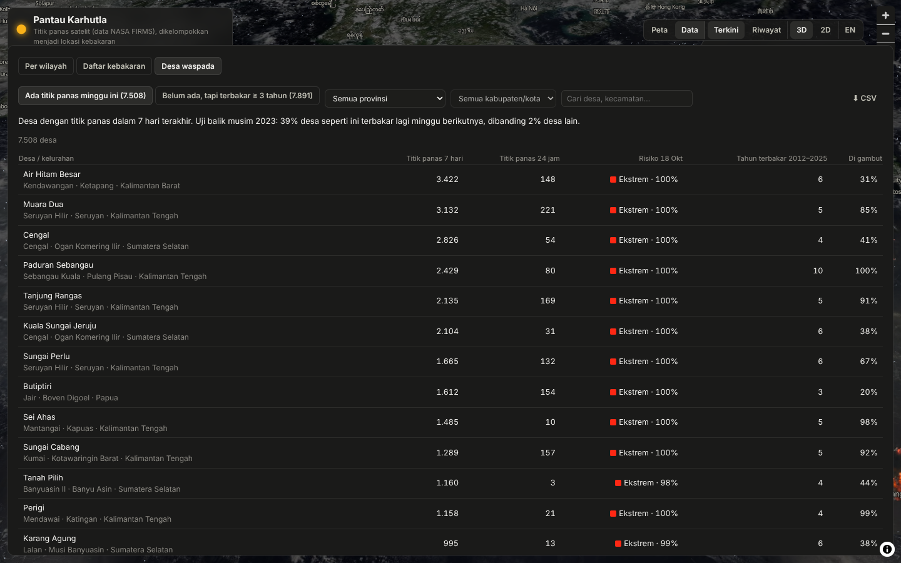
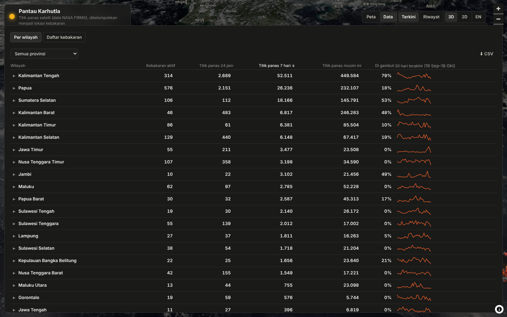
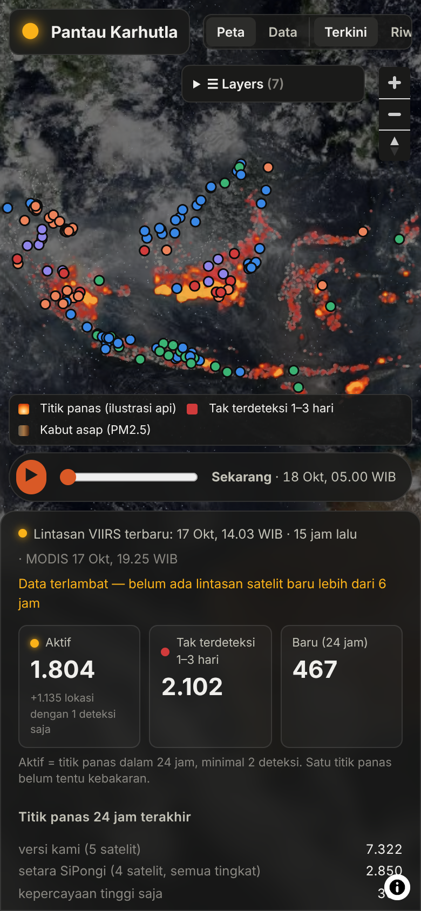
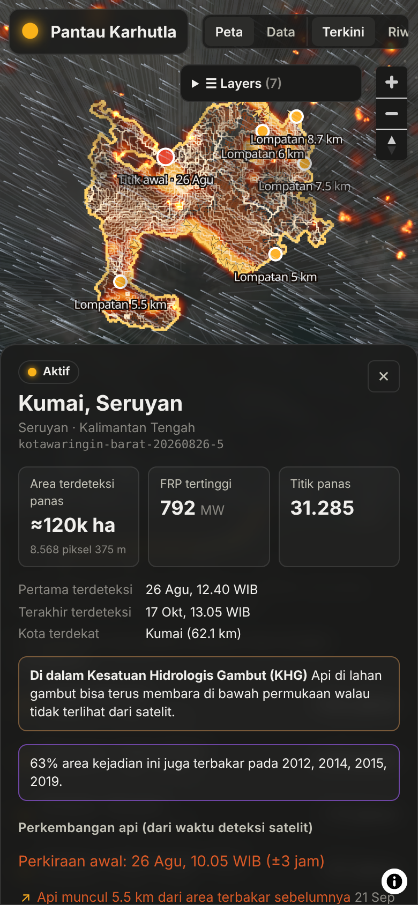

# haze — Pantau Karhutla

An independent, open-method tracker for Indonesia's forest and land fires
(karhutla) and the haze they make. It covers where it is burning, how fast
fires grow, where the smoke goes, what the air is like in each city, where
fire is likely next, and how much has burned. The burned-area number is
checked against satellite imagery, not just the official figures.

Bahasa Indonesia by default; English follows the browser locale or the toggle.
It is not a government site. Official numbers (SiPongi, BMKG, ISPU) are shown
next to ours, and where they disagree we show both and say how ours is made.



## What it shows (2026 season, as of 17 Oct)

| Finding | Number | How |
| --- | --- | --- |
| Burned area, season | **2.3–4.2 M ha** vs 202,011 ha official | Unique 375 m VIIRS fire pixels (single-satellite average) × 14.06 ha × k. k is fitted two ways: to KLHK's 2019/2023 totals (low end) and to the Gaveau et al. 2021 Sentinel-2 map (high end). See [docs/models.md](docs/models.md). |
| Independent check, Central Kalimantan | **≈ 664k ha** (95%: 374k–1.06M) vs 7,634 ha official | A stratified sample of 700 points labelled on Sentinel-1/2 and Landsat imagery, with an Olofsson/Stehman area estimator. Code and labels are in [research/burned_area](research/burned_area). |
| Burning again | **47%** of 2026 fire pixels (63% on peat) are on land that burned in 2012–2025 | That land is 11% of Indonesia, a 4.2× lift. A 2023 hindcast gives 5.1×. |
| Fire danger, next day | AUC **0.90** on the 2023 test season | NASA GFWED fire-weather codes (the system behind BMKG's SPARTAN), peat and recent fire, in a logistic model. "Extreme" cells burned the next day 65% of the time; "Low" cells 1.5%. |
| Air | CAMS reads at **0.39×** the stations under heavy haze | ISPU, Malaysia DOE and Singapore NEA stations correct the CAMS PM2.5 field. Leave-one-station-out error falls from 1.05 to 0.61 (median absolute log error). |

Every number has its method and caveats in [docs/models.md](docs/models.md) and
the audits in [docs/research](docs/research).

## Screens

| | |
| --- | --- |
|  |  |
| Each fire event: growth, progression and history | Haze and smoke plumes on 3D terrain, with a 72 h slider |
|  |  |
| Fire danger for the next 5 days, in BMKG class colours | Land that burned before (2012–2025) under today's fires |
|  |  |
| Villages burning this week and villages to watch, with measured hit rates | Tables by region and fire, with CSV/GeoJSON export |
|  |  |
| Phones get a 2D map and a bottom sheet | Fire pages on a phone |

## Features

| Area | What it does |
| --- | --- |
| Fires | NASA FIRMS VIIRS (S-NPP, NOAA-20, NOAA-21) and MODIS hotspots are clustered into fire events: ≤ 1.5 km and ≤ 48 h apart. Industrial heat (coal, refineries, smelters, volcanoes) is masked. Each event has an evidence tier: *strong* means ≥ 2 overpasses, ≥ 2 pixels in one pass, a night detection or a saturated pixel. Headline counts use strong events only. |
| Event page | Growth curve, day-by-day footprint, progression (ignition point, fire fronts, rate of spread, spotting jumps), peat share, and how much of the event burned in earlier years. Shareable URL: `#/event/<id>`. |
| Map | Daily NASA VIIRS true-colour imagery on 3D terrain. Fire is drawn as WebGL particles (marked as an illustration) and lit by the real sun position. Layers include stations, haze, smoke plumes, wind, fire danger, burned before, province/kabupaten borders and KHG peat. All of them can be toggled, and choices are remembered. |
| Air | PM2.5 corrected by measured stations, with a 0–72 h slider. The station list shows the worst current readings. A city table gives each city's daily-mean forecast with an uncertainty range, and when fire smoke arrives. |
| Health advice | For each forecast ISPU category, the school mode under SE Mendikdasmen 20/2026 and Kemenkes advice, for Indonesian cities. Every forecast is logged and scored against ISPU stations once the day has passed, next to a persistence baseline. |
| Cross-border | Which provinces' fires the smoke reaching each city comes from, including fires outside Indonesia. Shown only where the modelled smoke explains a meaningful share of what stations measure. |
| Desa waspada | Two village lists, each with its measured hit rate. Desa with hotspots this week burned again the next week 39% of the time in the 2023 hindcast. Desa not yet burning that burned in ≥ 3 years since 2012 burned the next week 11.6% of the time, 5× the 2.2% average. Each row has tomorrow's danger and peat share, with filters, CSV export and a map pin. Desa boundaries come from OCHA/BPS COD-AB. |
| Alerts | New and fast-growing fires, extreme fire danger by province, and unhealthy-air forecasts by city. They are published as Atom/RSS feeds, one national and one per province (`feeds/<provinsi>.xml`), for a feed reader, an email digest or a Telegram bot. Alerts are rebuilt every run from the last 7 days, and each one has a stable id. |
| Indonesia vs Southeast Asia | S-NPP hotspots per country for the last 7 days and every year 2012–2025, total or per 1,000 km², with Indonesia's year so far. The card says plainly that mainland countries usually burn more per km² (crop burning, Feb–Apr) and that Indonesia peaks Aug–Oct, often in peat. |
| Methodology | An (i) beside every number opens how it is calculated, which data it uses, how it was tested and its limits, in Bahasa and English. |
| Prevention | Fire danger 5 days ahead, a seasonal outlook (El Niño/ENSO, Indian Ocean Dipole, chance of a dry month), and repeat-burn areas. |
| History | Daily fires and PM2.5 since 1 July 2026, with playback. |
| Data | Region and fire tables with sparklines and filters, exported as CSV or GeoJSON. |

Forest-permit (PBPH) lookups per event are built but **not published**
(`HAZE_PUBLISH_LAND=1`): naming companies needs legal review first.

## Layout

```
pipeline/            Python package `haze` (uv): ingest, mask, tag, cluster, models, publish
  src/haze/          firms, db, mask, regions, cluster, events, publish, area, smoke, stations,
                     danger, outlook, progression, fire_history, verify, history, land, spread, cli
  static/            committed reference data and fitted models
  scripts/           model fitting (fit_danger.py)
  tests/
web/                 Vite + React + TypeScript, MapLibre GL 4
research/            independent burned-area estimate (sampling, labels, results)
docs/                models.md (methods + measured skill), research notes and audits, screenshots
.github/workflows/   ci.yml (lint + tests + build), pipeline.yml (every 2 h)
```

## Running it

```sh
cd pipeline && uv sync
uv run haze regions                     # boundaries, KHG peat, towns
export FIRMS_MAP_KEY=...                # https://firms.modaps.eosdis.nasa.gov/api/map_key/
uv run haze run                         # cold start backfills the season, then polls NRT
uv run haze backfill --since 2026-07-01 # refill FIRMS (SP over NRT), DEA, NEA; rebuild every page
uv run pytest

cd ../web && npm ci
ln -s /path/to/public public/data       # pipeline output (or set VITE_DATA_URL)
npm run dev                             # http://localhost:5173
npm run screenshots                     # headless Chromium -> screenshots/
```

Add `?perf` to the URL for a frame-rate and render-cost readout. The rules that
keep the 3D map smooth are in [docs/rendering-performance.md](docs/rendering-performance.md).

`haze run` is the scheduled job. Its steps are: ingest → tag → cluster →
publish → area → smoke + city forecasts → stations → history → fire danger →
seasonal outlook → fire history → progression → spread. Each model step can
fail without stopping the fire update.

| Command | Use |
| --- | --- |
| `haze archive <years>` | FIRMS yearly archives (no key) |
| `haze static-mask --merge` | add newly persistent industrial heat sources to the mask |
| `haze fire-history --build` | rebuild the 2012–2025 fire-history grid from the S-NPP archives |
| `haze smoke`, `haze stations`, `haze history`, `haze spread` | run one step |
| `python scripts/fit_danger.py …` | refit the fire-danger model |

## Secrets

| Where | Name | Needed for |
| --- | --- | --- |
| GitHub Actions secret | `FIRMS_MAP_KEY` | optional: an API cold start with standard-processing data. Without it, the pipeline uses the committed season seed and FIRMS' keyless 7-day files. |
| GitHub Actions secrets | `R2_ACCOUNT_ID`, `R2_ACCESS_KEY_ID`, `R2_SECRET_ACCESS_KEY` (+ var `R2_BUCKET`) | publishing to R2 (optional; until then the output is a workflow artifact) |

## Data sources

- **Fires:** NASA FIRMS. VIIRS S-NPP/NOAA-20/NOAA-21 and MODIS, NRT and standard archives. Plus [DEA Hotspots](https://hotspots.dea.ga.gov.au) (Geoscience Australia, CC BY 4.0): the same VIIRS passes by direct readout, ~1 h after a pass instead of FIRMS' 2–4 h. DEA stands in for a pass only until FIRMS delivers it, so counts stay comparable with the FIRMS-only history (`pipeline/src/haze/dea.py`).
- **Imagery:** NASA GIBS VIIRS true colour. Terrain: AWS Terrain Tiles. Basemap: OpenFreeMap / OpenStreetMap.
- **Air:** ISPU (KLH), Malaysia DOE APIMS, Singapore NEA, and Copernicus CAMS via Open-Meteo.
- **Weather and fire danger:** NASA GFWED (GEOS-5 forecasts, MERRA-2 for training), Open-Meteo, NOAA CPC (ONI, Niño 3.4) and the Bureau of Meteorology (IOD).
- **Official area:** SiPongi (KLHK/Kemenhut).
- **Places:** geoBoundaries IDN (BPS 2020 regencies), regrouped into the 38 provinces of 2022 (Papua Selatan, Tengah, Pegunungan, Barat Daya); KHG 2017 peat units (KLHK); GeoNames.
- **Research inputs:** Gaveau et al. 2021 (ESSD 13, 5353), Vetrita & Cochrane 2019, Hoscilo et al. 2011, de Groot et al. 2007, Field et al. 2016, and others cited in `docs/`.

## Licence

Code: MIT (see `LICENSE`). Data keeps its sources' terms: NASA FIRMS (open), DEA Hotspots (CC BY 4.0), CAMS via Open-Meteo (attribution), credited in the app.
